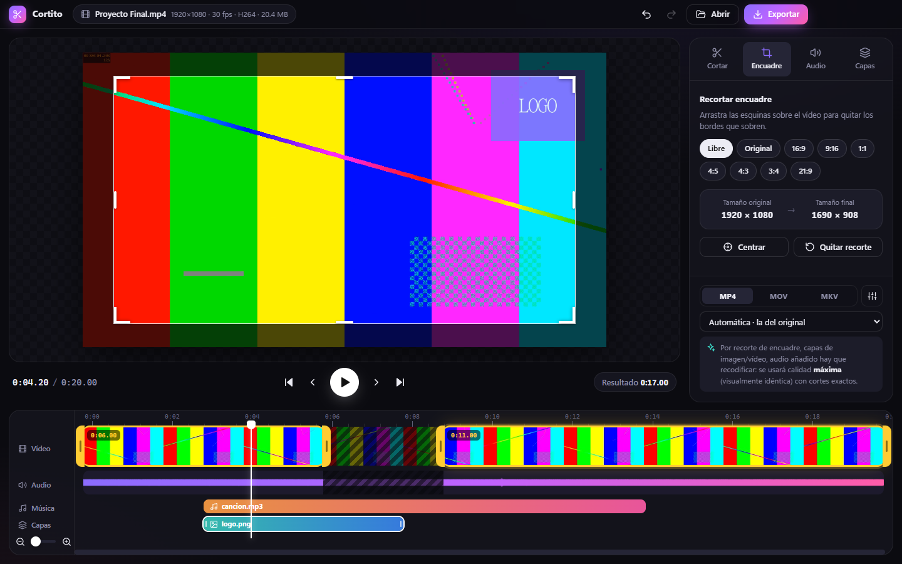

# Cortito

Editor de vídeo pequeñito para Windows, pensado para «cuatro tonterías»: recortar, quitar trozos, encuadrar, cambiar el audio y poner una foto o un vídeo encima, **sin perder calidad**.



## Qué hace

- **Cortar en la línea de tiempo**: arrastra los bordes amarillos para quitar el principio y el final, divide en el cabezal (`S`) y quita los tramos que sobren del medio (`Supr`). La vista previa ya salta los trozos quitados.
- **Recortar el encuadre** al estilo iPhone: arrastra las esquinas sobre el vídeo para quitar bordes. Proporciones libres o fijas (16:9, 9:16, 1:1, 4:5, 4:3…), con la resolución final a la vista.
- **Audio**: silenciar, subir o bajar el volumen, elegir otra pista si el vídeo tiene varias, y **añadir música** (o el audio de otro vídeo) mezclada o sustituyendo al original, con bucle y fundidos.
- **Capas**: pon un logo, una foto o un vídeo pequeño encima; muévelo y redimensiónalo sobre la imagen, con opacidad y el tramo de tiempo en que aparece.
- **Misma calidad que el original**:
  - Si solo cortas, se **copia el vídeo sin recodificar** (calidad idéntica y casi instantáneo; los cortes se ajustan al fotograma clave más cercano).
  - Si hay encuadre, capas o cambios de audio, se recodifica con calidad **visualmente idéntica** (H.264 CRF 14 o H.265 CRF 16, preset lento), se conservan la resolución, los fotogramas por segundo, los 10 bits y la información de color (HDR) y se copia el audio original cuando es posible.
- Abre casi cualquier formato (MP4, MOV, MKV, WEBM, AVI…). Si la vista previa no puede reproducir alguno, crea una copia ligera solo para verlo; el resultado siempre se hace desde el original.
- Deshacer y rehacer, arrastrar y soltar archivos y atajos de teclado.

## Atajos

| Tecla | Acción |
| --- | --- |
| `Espacio` | Reproducir / pausar |
| `←` `→` | Fotograma anterior / siguiente (`Mayús` = 1 segundo) |
| `S` | Dividir en el cabezal |
| `Supr` | Quitar el tramo (o la capa) seleccionado |
| `I` / `O` | Poner el inicio / fin del tramo en el cabezal |
| `M` | Silenciar el audio original |
| `1`–`4` | Cambiar de pestaña |
| `Ctrl+Z` / `Ctrl+Y` | Deshacer / rehacer |
| `Ctrl+O` / `Ctrl+E` | Abrir / exportar |
| `Ctrl` + rueda | Acercar o alejar la línea de tiempo |

Al soltar archivos con un vídeo abierto: un vídeo lo abre, una imagen la añade como capa y un audio como música (`Mayús` al soltar un vídeo lo añade como capa).

## Uso

Descarga `Cortito.exe` de la última release y ábrelo; es portable, no necesita instalación. Como el ejecutable no está firmado, Windows SmartScreen puede avisar la primera vez: pulsa «Más información» y «Ejecutar de todas formas».

### Desde el código

Necesitas [Node.js](https://nodejs.org/) 20 o superior.

```bash
npm install
npm start
```

Para generar el ejecutable portable en `dist/`:

```bash
npm run dist
```

## Cómo funciona

Cortito es una interfaz hecha con [Electron](https://www.electronjs.org/); todo el trabajo con el vídeo lo hace [FFmpeg](https://ffmpeg.org/), que va incluido. La aplicación traduce lo que haces en la interfaz (tramos, encuadre, capas, mezcla de audio) a una orden de FFmpeg y elige automáticamente entre copiar los flujos sin tocar o recodificar con la máxima calidad.

## Licencia

El código de Cortito se publica bajo la licencia [MIT](LICENSE). Copyright (c) 2026 Dreex.

Cortito incluye o usa estos componentes de terceros, cada uno con su propia licencia:

| Componente | Uso | Licencia |
| --- | --- | --- |
| [FFmpeg](https://ffmpeg.org/) (compilación de [gyan.dev](https://www.gyan.dev/ffmpeg/builds/)) | Análisis, vista previa y exportación de vídeo | [GPL-3.0](https://www.gnu.org/licenses/gpl-3.0.html) |
| [ffmpeg-static](https://github.com/eugeneware/ffmpeg-static) | Distribución del binario de FFmpeg | [GPL-3.0-or-later](https://github.com/eugeneware/ffmpeg-static/blob/master/LICENSE) |
| [ffprobe-static](https://github.com/joshwnj/ffprobe-static) | Distribución del binario de FFprobe | [MIT](https://github.com/joshwnj/ffprobe-static/blob/master/LICENSE) |
| [Electron](https://www.electronjs.org/) | Interfaz de escritorio | [MIT](https://github.com/electron/electron/blob/main/LICENSE) |
| [electron-builder](https://www.electron.build/) | Generación del ejecutable | [MIT](https://github.com/electron-userland/electron-builder/blob/master/LICENSE) |
| [Lucide](https://lucide.dev/) | Diseño de los iconos | [ISC](https://github.com/lucide-icons/lucide/blob/main/LICENSE) |

FFmpeg se ejecuta como un programa independiente; su código fuente está disponible en [ffmpeg.org](https://ffmpeg.org/download.html).

### Exención de responsabilidad

El autor no se hace responsable del uso que se haga del programa ni del contenido que se procese u obtenga con él. Asegúrate de tener derecho a usar los vídeos, imágenes y músicas que edites.

---

Hecho por **Dreex**.
